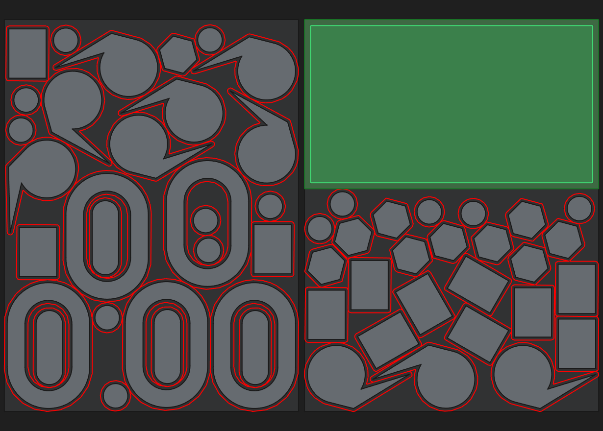
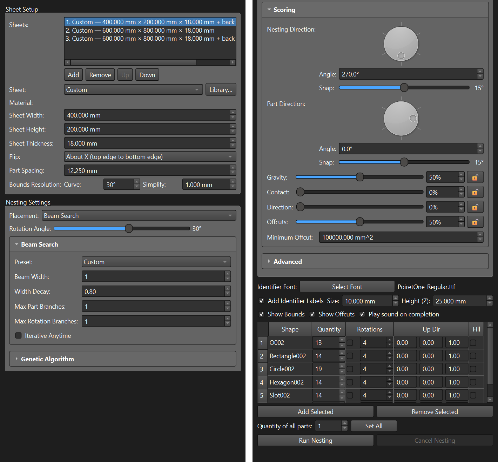
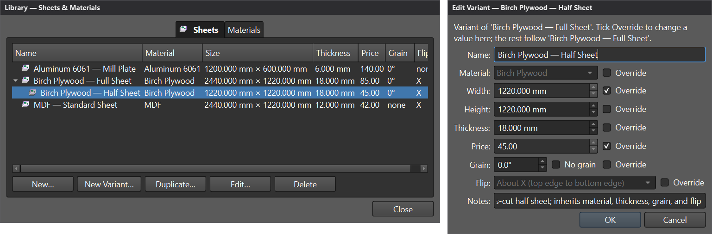
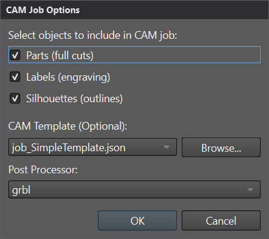
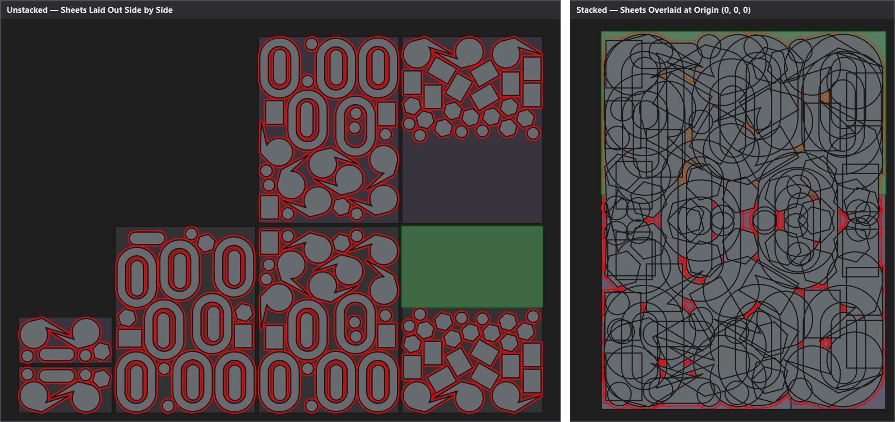
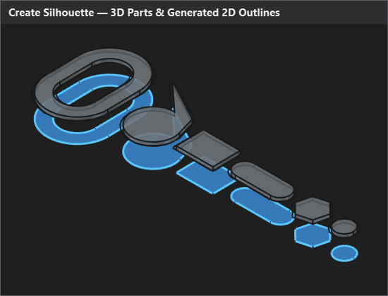
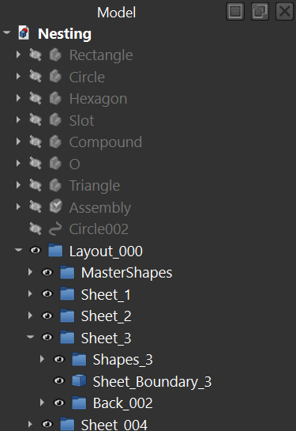

# FreeCAD Nesting Workbench

A 2D nesting (bin-packing) workbench for FreeCAD that packs 2D shapes and 3D solids onto flat material sheets for CNC routing, laser cutting, plasma, and waterjet jobs. It uses exact No-Fit Polygon (Minkowski sum) collision geometry paired with Greedy or Beam Search placement and a multi-process Genetic Algorithm optimizer, producing live FreeCAD document objects ready for downstream CAM toolpaths or DXF export. See [CHANGELOG.md](CHANGELOG.md) for what changed in each release.

<!--
================================================================================
PHOTO_TODO — README SCREENSHOT GENERATION INSTRUCTIONS
================================================================================
Save screenshots in `docs/images/README_<Subject>.png` (PNG, <= 500 KB each),
prefix each `[alt](docs/images/...)` placeholder below with `!` and uncomment it
once captured. When `docs/images/` is populated, also add `"docs/images"` to
`PUBLIC_PATHS` in the publish map so the release build ships the images.

General capture rules:
1. Open `Resources/examples/Nesting.FCStd` in a live FreeCAD session.
2. Hide every toolbar except the Nesting toolbar so the window is clean, and close
   extra dock panels (Report view, Python console, Selection view) unless the shot
   specifically shows the Tasks panel.
3. Never include OS window borders, the taskbar, personal file paths, usernames, or
   unrelated open documents.
4. Set the 3D view background to a solid neutral colour before saving:
     Gui.ActiveDocument.ActiveView.setBackgroundColor(0.95, 0.95, 0.96)
5. Frame the subject tightly (`Gui.SendMsgToMainWindow("ViewFit")`).

Capture recipes (run on the FreeCAD GUI thread):
- 3D viewport only (1600x1000):
    view = Gui.ActiveDocument.ActiveView
    view.viewTop()
    Gui.SendMsgToMainWindow("ViewFit")
    view.saveImage("docs/images/README_<Subject>.png", 1600, 1000, "Current")
- Main window or dialog with Task panel / Library dialog visible:
    from PySide import QtWidgets
    mw = Gui.getMainWindow()
    mw.resize(1600, 1000)
    QtWidgets.QApplication.processEvents()
    mw.grab().save("docs/images/README_<Subject>.png")

Planned shots:
1. `docs/images/README_Hero.png` (Hero — right below this comment):
   - Open `Resources/examples/Nesting.FCStd`, select the sample parts, open the
     Nesting task panel (`Nesting_Run`), and run nesting onto a sheet with
     `Show Bounds` and `Show Offcuts` enabled.
   - Capture the main window (`1600x1000`) showing the Nesting task panel on the
     left and the top-down nested sheet with parts, identifier labels, and tinted
     offcut rectangles in the 3D viewport on the right.
2. `docs/images/README_NestingPanel.png` (under `### Nesting`):
   - Capture the Nesting task panel showing `Sheet Setup`, `Nesting Settings`
     (`Scoring` weights and direction dials visible), and the parts table populated.
3. `docs/images/README_SheetLibrary.png` (under `### Library`):
   - Open `Nesting_Library` with a root sheet and a child variant selected, plus the
     `Edit Variant` dialog open showing `Override` checkboxes.
4. `docs/images/README_CAMJob.png` (under `### Create CAM Job`):
   - Run `Nesting_CreateCAMJob` on the finished `Layout` group and capture the 3D
     view with the generated CAM toolpaths and `CAM Job Options` dialog.
5. `docs/images/README_QuickStart.png` (under `## Quick start`):
   - Capture the completed `Layout` tree in the Model tab alongside the nested
     sheets in the 3D view (`viewTop()` + `ViewFit`, `1600x1000`).
================================================================================
-->

## Tools

###  Nesting

**Run Nesting Tool** (`Nesting` → `Run Nesting Tool`) packs selected 2D profiles (`Sketcher::SketchObject`, `Draft` wires/faces) and 3D solids (`Part::Feature`, `PartDesign::Body`, `App::Part`, `App::Link`) onto one or more rectangular sheets.

- **Ordered sheet sequence & Library sheets:** Mix saved Library sheets and `Custom` sizes in `Sheets:`. Sheets are filled in order and the final entry repeats as needed.
- **Two-sided (`Flip`) sheets:** Flip a sheet `About X` or `About Y` to place a paired back-side sheet above the front sheet so two-sided parts and back-side features stay aligned.
- **Exact NFP placement (`Greedy` & `Beam Search`):** Computes exact No-Fit Polygons (Minkowski sums) so concave parts interlock and small parts nest inside holes, using single-pass **Greedy** or multi-branch **Beam Search** (`Default`, `Balanced`, `Thorough`).
- **Multi-process Genetic Algorithm:** Evolves part ordering, rotation step counts, beam schedules, and nesting directions across parallel worker processes (`Single run`, `Balanced`, `Thorough`).
- **Four-weight Scoring & offcut preview:** Balance **Gravity**, **Contact**, **Direction**, and **Offcuts** with linked percentage sliders (`🔓`/`🔒`) and **Nesting Direction** / **Part Direction** dials. `Show Offcuts` tints reusable free rectangles of at least `Minimum Offcut` area directly on each sheet.
- **Per-part table & labels:** Set copy `Quantity` (or bulk `Set All`), per-part `Rotations`, 3D `Up Dir` `(X, Y, Z)`, `Fill` mode, and optional 3D `Identifier Labels`. Preview objects live in a temporary `Layout_temp_*` group that commits on **OK** or cleans up on **Cancel**.

Nesting Panel Reference (Sheet Setup, Beam Search, Genetic Algorithm, Scoring &amp; Advanced)

#### Sheet Setup

| Control | Default | Description |
|---|---|---|
| **Sheets** (`Add` / `Remove` / `Up` / `Down`) | 1 Custom sheet | Ordered list of sheets used for the job. The final row is marked `(repeats)` and repeats as needed. |
| **Sheet** / **Library…** | `Custom` | Picks a saved sheet from the Library (locking width, height, thickness, and flip) or `Custom` to enter values directly. |
| **Sheet Width / Height / Thickness** | `600 mm` / `600 mm` / `3 mm` | Stock sheet dimensions in your FreeCAD unit system. |
| **Flip** | `None (one side)` | `None (one side)`, `About X (top edge to bottom edge)`, or `About Y (left edge to right edge)` for two-sided machining. |
| **Part Spacing** | `12.5 mm` | Minimum clearance kept between parts and sheet edges (`0` allows parts to touch). |
| **Bounds Resolution — Curve** | `30°` | Maximum angular deviation (`1°–90°`) when approximating curved edges as polygons. Smaller angles produce smoother curves. |
| **Bounds Resolution — Simplify** | `1 mm` | Tolerance for removing redundant boundary vertices (`0.001–10 mm`). |

#### Nesting Settings &amp; Rotation

| Control | Default | Description |
|---|---|---|
| **Placement** | `Greedy` | `Greedy` places one part at a time at the best candidate point; `Beam Search` retains multiple top partial layouts at each depth. |
| **Rotation Angle** | `90° (4 steps)` | Global rotation step slider (`1` step = `360°`, `2` = `180°`, `3` = `120°`, `4` = `90°`, `6` = `60°`, `8` = `45°`, `12` = `30°`, `16` = `22.5°`, `24` = `15°`, `36` = `10°`, `72` = `5°`). Individual parts can override this in the parts table. |

#### Beam Search (shown when Placement is `Beam Search`)

| Control | Default | Description |
|---|---|---|
| **Preset** | `Default (W=1, fast greedy)` | `Default (W=1, fast greedy)`, `Balanced (W=4, iterative)`, `Thorough (W=8, iterative)`, or `Custom`. |
| **Beam Width** | `1` | Number of top partial sheet layouts kept after each part is placed (`1–64`). |
| **Width Decay** | `1.00` | Multiplies the active beam width after each placed part (`width × decay^parts`, `0.50–1.00`). |
| **Max Part Branches** | `1` | Maximum distinct remaining part types branched on at each step (`1–16`). |
| **Max Rotation Branches** | `1` | Maximum alternative rotations branched on per part type at each step (`1–32`). |
| **Iterative Anytime** | Off | Runs successive doubling passes (`W = 1, 2, 4, …` up to `Beam Width`), keeping the best layout found so far. |

#### Genetic Algorithm

| Control | Default | Description |
|---|---|---|
| **Preset** | `Single run (1 pop, 1 gen)` | `Single run (1 pop, 1 gen)`, `Balanced (10 pop, 10 gen)`, `Thorough (10 pop, 20 gen)`, or `Custom`. |
| **Generations** | `1` | Number of evolutionary cycles (`1–1000`). Needs `Population Size > 1` to evolve. |
| **Population Size** | `1` | Number of candidate genomes evaluated per generation (`1–500`). |
| **Winners** | `3` | Number of top members that breed the next generation (`1–500`, clamped to `Population Size`); the single best member is also kept unchanged (elitism). |
| **Mutation Rate** | `0.10` | Probability (`0.00–1.00`) of replacing each child gene with a random value after crossover. |

#### Scoring

The four scoring weights always sum to `100%` (lock any weight with `🔓`/`🔒` to hold it fixed while adjusting the others). Fewer sheets used and placing every part always take priority over the sub-sheet weights:

$$\text{Fitness} = A_{\text{sheets}} + w_g A_{\text{bbox}} + w_o (A_{\max} - V_{\text{offcut}}) + w_c A_{\max} (1 - C) + w_d A_{\max} D + P_{\text{unplaced}}$$

| Control | Default | Description |
|---|---|---|
| **Nesting Direction** | `0°` (`Snap: 15°`) | Direction dial and angle spinbox (`0°` = Right, `90°` = Up, `180°` = Left, `270°` = Down) setting the gravity pull direction. |
| **Let the GA Vary Direction** | Off | Allows GA population members to explore different nesting directions (`Greedy` placement only). |
| **Part Direction** | `0°` (`Snap: 15°`) | Target orientation angle for parts, measured from how each part is drawn (`180°` also counts as aligned). |
| **Gravity** ($w_g$) | `50%` | Pulls each placement toward `Nesting Direction` and rewards a smaller bounding box on the final sheet. |
| **Contact** ($w_c$) | `0%` | Rewards shared outline length where a part's spaced boundary runs along neighbouring parts or sheet edges. |
| **Direction** ($w_d$) | `0%` | Rewards parts aligned with `Part Direction` (`0°` or `180°` deviation). |
| **Offcuts** ($w_o$) | `50%` | Rewards leaving large, squarish free rectangles of at least `Minimum Offcut` area across all sheets. |
| **Minimum Offcut** | `0.1 m²` | Smallest free rectangle counted as a reusable offcut; smaller leftover pieces are treated as scrap. |

#### Advanced

| Control | Default | Description |
|---|---|---|
| **Simulation** | `Single` | `Off` draws only the final layout; `Single` draws one layout at a time; `All` draws every GA population member in a grid while worker processes run. |
| **Verbose Logging** | Off | Prints detailed step-by-step nesting diagnostics to the FreeCAD Report view. |
| **Candidate Spacing** | `5 mm` | Distance between sample points checked along placement edges (`1–100 mm`). Smaller spacing checks tighter corners at the cost of time. |
| **GA worker processes** | `Auto` (`0`) | Number of parallel worker processes for GA evaluation (`Auto` uses up to one process per physical CPU core, batch-balanced; `1` runs in-process). |
| **Clear NFP Cache** | Off | Forces recalculation of cached No-Fit Polygons on the next run. |

###  Library

**Library…** (`Nesting` → `Library…`, or the **Library…** button in the Nesting panel) manages your reusable stock sheets and material names across FreeCAD documents.

- **Sheets tab:** Create, duplicate, edit, and delete stock sheets with **Name**, **Material**, **Width**, **Height**, **Thickness**, **Price**, two-sided **Flip** (`None`, `About X`, `About Y`), and **Notes**.
- **Sheet variants:** Click **New Variant…** on any sheet to create a child variant that inherits its parent's fields and updates automatically when the parent changes, with per-field **Override** checkboxes for values that differ (such as half-sheets or alternate thicknesses).
- **Materials tab:** Add, rename, and delete material names (seeded with common sheet goods on first use) and see how many library sheets reference each material. Renaming a material updates every sheet that uses it.

###  Create CAM Job

**Create CAM Job** (`Nesting` → `Create CAM Job`) builds a FreeCAD CAM (Path) job directly from a selected `Layout` group.

- **Object selection:** Choose whether to include **Parts (full cuts)**, **Labels (engraving)**, and **Silhouettes (outlines)** in the job's model group.
- **Templates & post-processors:** Pick any installed or custom `.json` CAM job template (with a **Browse…** button for files on disk) and choose the target **Post Processor** (such as `grbl`, `linuxcnc`, or `centroid`).
- **Two-sided support:** When a layout contains sheets with a back side (`+ back`), `Create CAM Job` automatically creates a second CAM job for the flipped back-side operations.

###  Export Sheets as DXF

**Export Sheets as DXF** (`Nesting` → `Export Sheets as DXF`) exports each `Sheet_N` group in the selected `Layout` to its own `.dxf` file in a chosen directory (defaulting to `~/Downloads/<Layout>_DXF_Export`), with an option to delete or keep the temporary 2D projection views created during export.

###  Stack/Unstack Sheets

**Stack/Unstack Sheets** (`Nesting` → `Stack/Unstack Sheets`) toggles the sheets in the selected `Layout` group between laid out side by side along the X axis and stacked at the origin (`0, 0, 0`), which is useful when referencing a consistent machine origin for CAM operations.

###  Create Silhouette

**Create Silhouette** (`Nesting` → `Create Silhouette`) generates 2D outer boundary faces from selected 3D parts, nested part containers (`nested_*`), or an entire `Layout` group.

###  Import as Sketches

**Import as Sketches…** (`Nesting` → `Import as Sketches…`) imports `.dxf` and `.svg` drawings as one `Sketcher::SketchObject` per disconnected part, keeping inner holes with their outer boundary and converting open geometry into construction lines so imported parts are ready to nest or extrude immediately.

### Nesting Settings &amp; About

- **Nesting Settings** (`Nesting` → `Nesting Settings`): Sets the currency symbol prefix used for sheet prices in the Library (for example `$`, `€`, or `£`) and toggles persistent crash logs (`Nesting.log` in FreeCAD's user data directory) and verbose debug output in the Report view.
- **About Nesting Workbench** (`Nesting` → `About Nesting Workbench`): Displays the installed workbench version from `package.xml` and a link to support development.

## Requirements

- **FreeCAD:** 26.3 or later.

## Installation

### FreeCAD Addon Manager (recommended)

1. Open FreeCAD and go to **Tools → Addon Manager**.
2. Search for **Nesting** (or add `https://github.com/StevePeters-US/Freecad-Nesting-Workbench` under **Edit → Preferences → Addon Manager → Custom Repositories** with branch `main`).
3. Click **Install** and restart FreeCAD when prompted.

### Manual installation

1. Download or clone `https://github.com/StevePeters-US/Freecad-Nesting-Workbench` into your FreeCAD `Mod` directory:
   - **Windows:** `%APPDATA%\FreeCAD\Mod\Nesting\`
   - **Linux:** `~/.local/share/FreeCAD/Mod/Nesting/`
   - **macOS:** `~/Library/Application Support/FreeCAD/Mod/Nesting/`
2. Restart FreeCAD and select **Nesting** from the workbench selector.

## Quick start

1. Open the bundled example file `Resources/examples/Nesting.FCStd` in FreeCAD (or open a document containing 2D sketches or 3D solids), then switch to the **Nesting** workbench.
2. Select the parts you want to pack in the Model tree or 3D view and click **Run Nesting Tool** on the toolbar.
3. In **Sheet Setup**, pick a saved sheet from **Sheet** (or leave **Custom** and enter **Sheet Width**, **Sheet Height**, and **Part Spacing**).
4. In the parts table, adjust **Quantity**, per-part **Rotations**, **Up Dir**, or **Fill** as needed, then click **Run Nesting**.
5. Inspect the nested sheets and tinted offcut rectangles in the 3D view, then click **OK** at the top of the Tasks panel to commit the `Layout` group (or **Cancel** to discard the preview).
6. Select the finished `Layout` group in the Model tree and click **Export Sheets as DXF** or **Create CAM Job**.

## Known issues

- **Projection-method silhouettes on nested containers:** When `Create Silhouette` falls back to 3D projection on a part inside a transformed `App::Part` container, the projected face can be offset from the container's origin. Cross-section silhouettes (the default for flat prism parts) are unaffected.

Report bugs or feature requests on the [GitHub issue tracker](https://github.com/StevePeters-US/Freecad-Nesting-Workbench/issues).

## Support

If this workbench saves you time or material in the shop, you can [support development on Patreon](https://www.patreon.com/cw/AttackPotato).

## License

Code is licensed under **LGPL-2.1-or-later** — see [LICENSE](LICENSE). Icons, fonts, and media assets are licensed under **CC-BY-4.0** / **OFL-1.1** — see [LICENSE-Assets](LICENSE-Assets).
